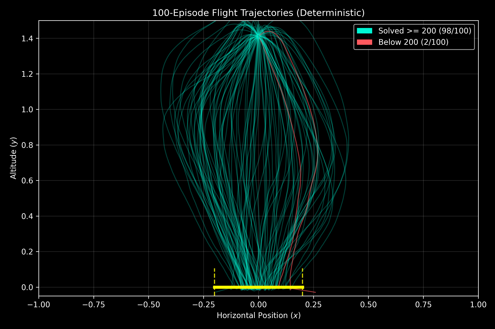
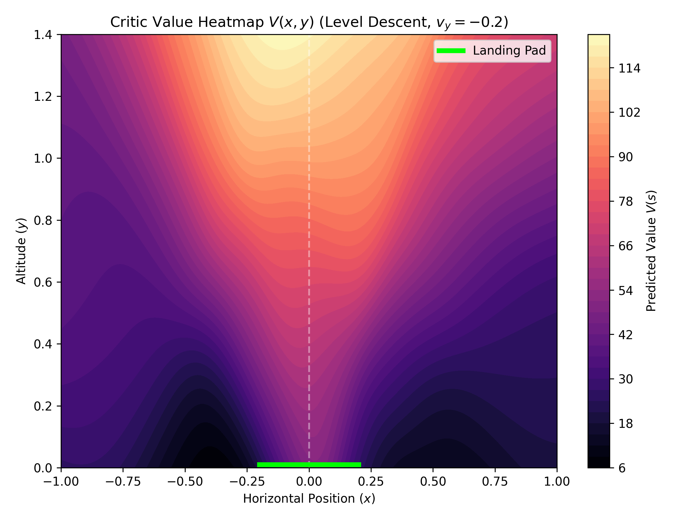
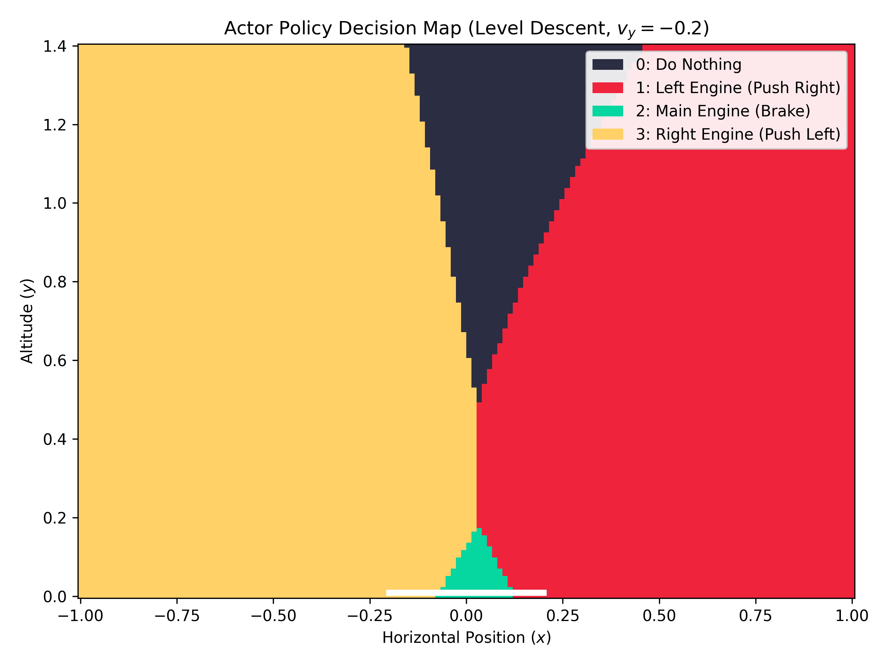
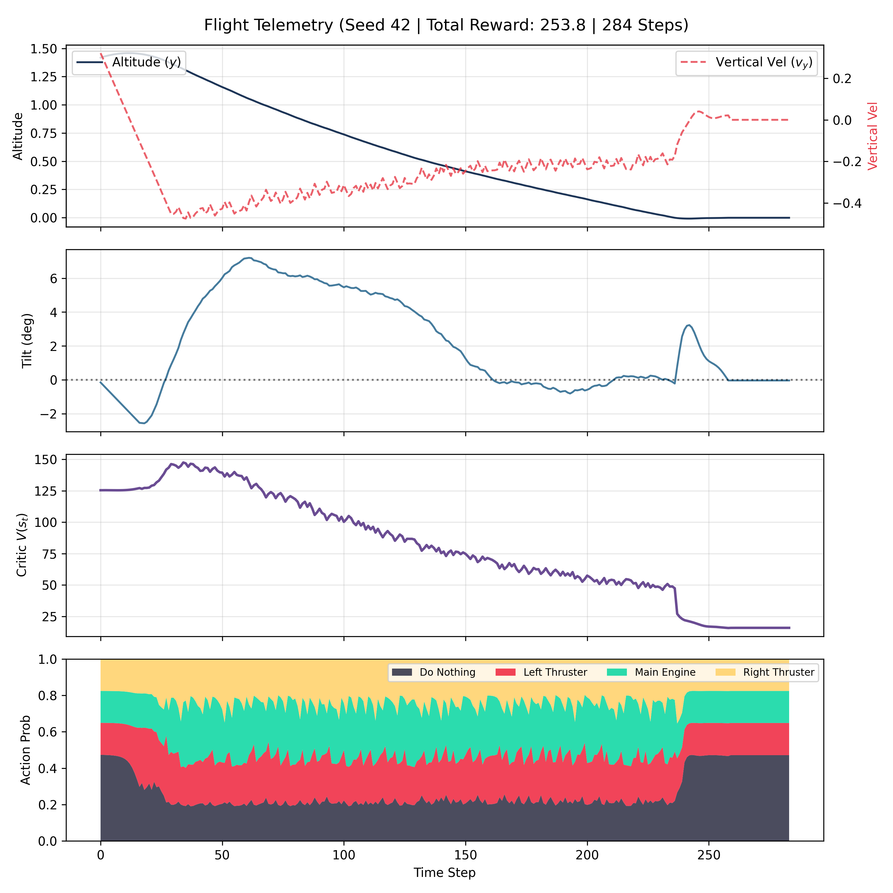

# PPO from Scratch — LunarLander-v3 (PyTorch)
https://github.com/user-attachments/assets/d132e5b1-af06-4513-b20f-63d1c9933cce

A clean, from-scratch PyTorch implementation of **Proximal Policy Optimization (PPO)** with Generalized Advantage Estimation (GAE) trained to solve Gymnasium's `LunarLander-v3` environment.

<!-- Tip: In GitHub's web editor, just drag and drop your .mp4 video here and GitHub will auto-embed a video player! -->

## Results (100-Episode Evaluation)

The environment is considered solved at an average reward of **+200**.

| Mode | Mean Reward | Success Rate ($\ge 200$) |
| :--- | :---: | :---: |
| **Deterministic (`argmax`)** | `~265 ± 20` | `~95%` |
| **Stochastic (`sample`)** | `~255 ± 35` | `~90%` |

## Model Analysis & Visualizations

### 100-Episode Flight Trajectories
Consistent landing precision across 100 random terrains and spawn impulses.

### Inside the Agent's Brain
2D slices of the Critic's value function $V(x, y)$ and the Actor's policy decision boundaries during a level descent ($v_y = -0.2$):

| Critic Value Heatmap | Actor Decision Map |
| :---: | :---: |
|  |  |

### Single-Episode Flight Telemetry
Altitude, vertical velocity, tilt angle, Critic value prediction, and thruster probabilities over a full landing:

## Key Implementation Details
* **Algorithm:** Clipped PPO ($\epsilon = 0.2$) with GAE ($\gamma = 0.99$, $\lambda = 0.95$)
* **Updates:** Shuffled mini-batch gradient descent (`K_epochs = 10`), which was essential for breaking out of the early "hovering" local optimum
* **Architecture:** Separate Actor and Critic MLPs (`Tanh` activations)

## References

1. **PPO:** J. Schulman, F. Wolski, P. Dhariwal, A. Radford, and O. Klimov, *"Proximal Policy Optimization Algorithms,"* arXiv:1707.06347, 2017. [[Paper]](https://arxiv.org/abs/1707.06347)
2. **GAE:** J. Schulman, P. Moritz, S. Levine, M. Jordan, and P. Abbeel, *"High-Dimensional Continuous Control Using Generalized Advantage Estimation,"* ICLR, 2016. [[Paper]](https://arxiv.org/abs/1506.02438)
3. **Gymnasium:** M. Towers, A. Kwiatkowski, J. Terry, et al., *"Gymnasium: A Standard Interface for Reinforcement Learning Environments,"* NeurIPS Datasets and Benchmarks, 2025. [[Paper]](https://arxiv.org/abs/2407.17032)
4. **Environment:** Farama Foundation, *"LunarLander-v3 Documentation,"* Gymnasium. [[Docs]](https://gymnasium.farama.org/environments/box2d/lunar_lander/)

